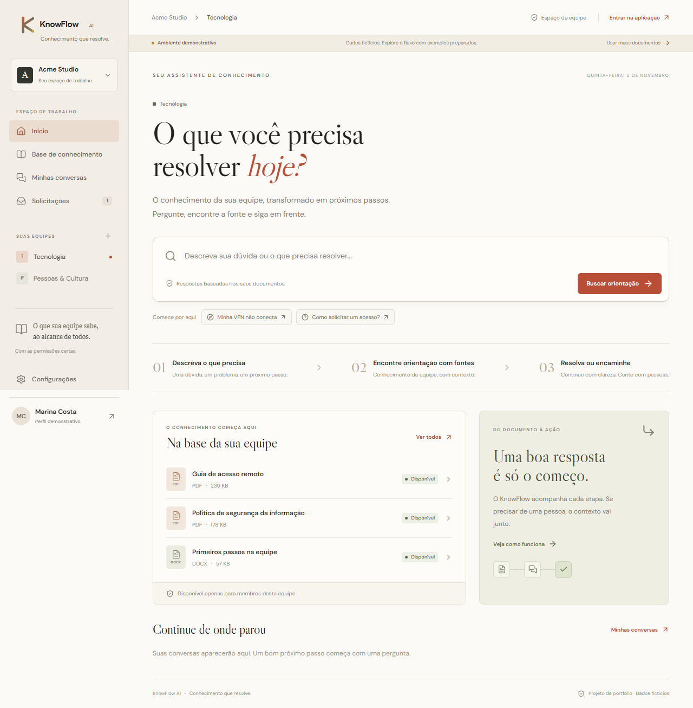
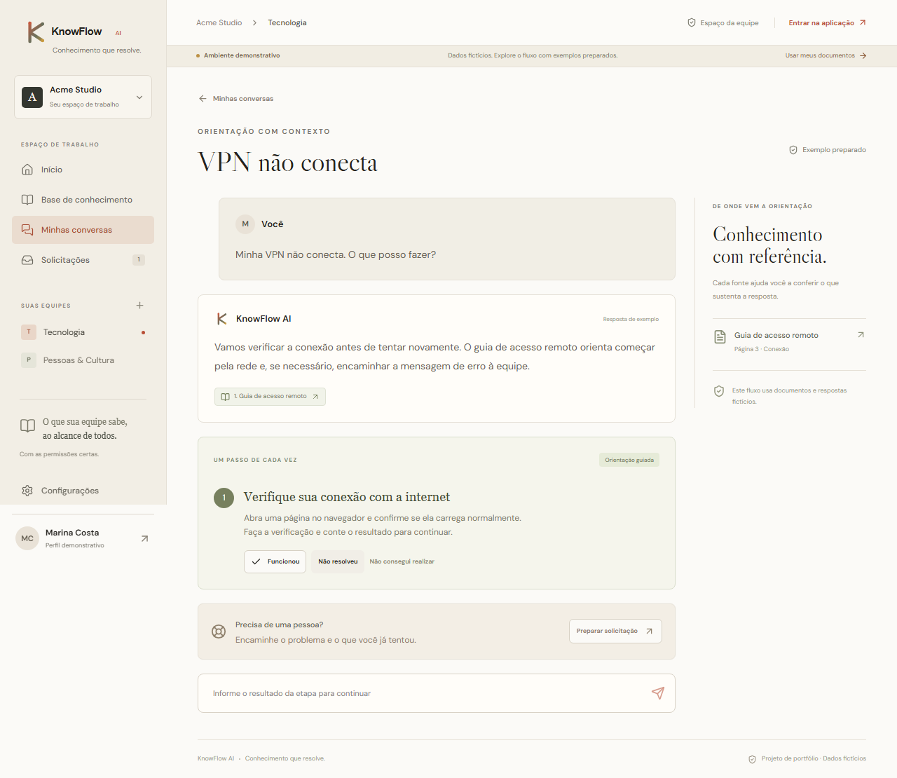
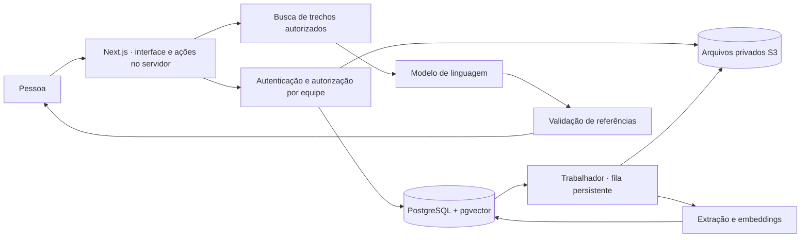

<p align="center"></p>
<p align="center"><strong>Conhecimento que resolve.</strong><br>Documentos da equipe → orientação com fontes → próximos passos → atendimento humano.</p>



## O problema

Equipes acumulam manuais, políticas e procedimentos, mas consultar esse conhecimento no momento certo continua difícil. KnowFlow AI organiza documentos em espaços de equipe e transforma seu conteúdo em respostas verificáveis e orientação guiada. Quando a documentação não basta, a pessoa pode compartilhar um resumo revisado com o atendimento humano.

Projeto de portfólio, sem cobrança ou proposta comercial. As pessoas, organizações e políticas usadas nos exemplos são fictícias.

## Experimente em dois modos

**Demonstração, sem credenciais:** `/demo` tem exemplos preparados de Tecnologia e Pessoas & Cultura. É possível abrir fontes fictícias, informar resultados de etapas e registrar solicitações de exemplo. As alterações duram apenas durante a sessão da página. Perguntas livres, upload e convites reais exigem a aplicação configurada. A demo nunca chama a IA nem representa pesquisa real.

**Aplicação integrada:** `/login` permite cadastro e acesso; `/app` abre as equipes autorizadas. Requer PostgreSQL, armazenamento privado e configuração de autenticação. A busca documental e a ingestão com embeddings também requerem a chave de IA.

## Funcionalidades

- Organizações com múltiplos espaços de equipe, membros e convites de uso único válidos por sete dias.
- Administrador na organização; gestor e membro por equipe. Administradores precisam participar da equipe para consultar conteúdo.
- Upload de PDF com texto, DOCX e TXT (UTF-8), até 20 MB. Processamento persistente em segundo plano, estados visíveis e repetição após falha.
- Busca vetorial limitada à equipe, respostas com fontes e localização: página em PDF; parágrafo em DOCX/TXT.
- Conversas privadas e orientação com resultado de cada etapa persistido.
- Solicitações com resumo editável, confirmação explícita, comentários, responsável e acompanhamento.
- Interface responsiva em português, navegação por teclado, formulários identificados e diálogos com foco contido.



## Executar a demonstração

Requisitos: Node.js **22.17 ou posterior** e npm. Nenhuma credencial é necessária para `/demo`.

```sh
npm ci
npm run dev
```

Abra [localhost:3000/demo](http://localhost:3000/demo). Para compilar e servir a versão de produção:

```sh
npm run build
npm start
```

As fontes web têm alternativas locais do sistema; se o serviço de fontes estiver indisponível, a aplicação continua utilizável.

## Executar a aplicação completa

1. Copie `.env.example` para `.env` e configure `BETTER_AUTH_SECRET` com um valor aleatório de pelo menos 32 caracteres. Gere-o com:

   ```sh
   node -e "console.log(require('node:crypto').randomBytes(32).toString('base64'))"
   ```

2. Instale Docker com Compose e inicie os serviços locais:

   ```sh
   docker compose up -d
   npm ci
   npm run db:migrate
   ```

3. Configure `OPENAI_API_KEY`. O padrão usa `gpt-4.1-mini` para geração e `text-embedding-3-small` com 1.536 dimensões para embeddings. Ao trocar o modelo de embeddings, reenvie os documentos; não misture vetores de modelos diferentes.

4. Crie o bucket privado `knowflow` no console local do armazenamento em [localhost:9001](http://localhost:9001), ou use o seed abaixo, que cria o bucket. Os valores do Compose são exclusivos para desenvolvimento e os serviços ficam vinculados ao loopback.

5. Opcionalmente, defina `ALLOW_LOCAL_SEED=true` e execute:

   ```sh
   npm run db:seed
   ```

   O seed é restrito ao banco local `knowflow`/`knowflow_demo` e não roda em produção. Cria organizações fictícias, equipes de Tecnologia e Pessoas & Cultura, documentos de exemplo e uma solicitação. Contas locais: `marina@example.test`, `rafael@example.test`, `ana@example.test`; senha de demonstração: `KnowFlow-local-2026!`. Não use essas credenciais em implantação pública.

6. Em terminais separados, execute:

   ```sh
   npm run worker
   npm run dev
   ```

   Abra [localhost:3000/login](http://localhost:3000/login). Sem worker, uploads permanecem na fila. Sem chave de IA, o processamento falha de forma visível e pode ser repetido depois de configurar o serviço.

Não há envio de email: gestores copiam o link de convite para compartilhar com o destinatário, que precisa entrar com o email correspondente. Verificação de propriedade do email e recuperação de senha via email não estão incluídas nesta versão de portfólio.

## Arquitetura e decisões



Next.js App Router e TypeScript concentram interface e serviços. Better Auth usa o adapter Drizzle; PostgreSQL armazena entidades relacionais, auditoria, fila e vetores. Consultas parametrizadas e chaves estrangeiras compostas preservam os vínculos entre equipe e organização. A migração SQL inicial é versionada e aplicada de forma transacional, com controle de aplicação e lock.

A fila usa claim atômico, lease recuperável, no máximo três tentativas e conferência de exclusão antes de publicar trechos. O trabalhador compartilha código com a aplicação, mas roda em processo próprio. S3 mantém os arquivos privados; o servidor autoriza cada download. Não há serviço Redis nem API Python separada.

A IA recebe apenas trechos da equipe autorizada, a pergunta e histórico limitado. A resposta estruturada passa por validação de IDs de fontes. Quando falta evidência, o assistente reconhece a lacuna. Não há ferramentas de execução ou ações em sistemas externos. Essa validação impede fontes inventadas; **não prova por si só que cada afirmação está semanticamente correta**. Avaliação humana dos documentos e respostas continua necessária.

### Privacidade e limites

- Conversas são do autor. Gestores veem somente o resumo que foi confirmado na solicitação, não a conversa inteira.
- Remover participação revoga acesso aos endpoints de conteúdo. Administradores podem gerenciar equipes; ingresso explícito em equipe para consulta é auditado.
- Excluir um documento o remove da busca imediatamente e agenda a remoção do arquivo e dos trechos. O texto de respostas já geradas pode permanecer no histórico privado; a fonte excluída fica indisponível.
- O provedor externo de IA processa conteúdo dos trechos, perguntas e contexto. Só envie documentos apropriados a esse processamento. Segredos do servidor não entram no navegador.
- Dez gerações por minuto por usuário, timeout de 45 segundos e até 2.000 tokens por resposta. O limite da autenticação usa a memória da instância; implantação distribuída precisaria de coordenação desse limite.
- Não há OCR, versão de documento, recuperação de senha por email, integrações, notificações externas, cobrança ou administração comercial.
- Esta entrega é uma aplicação de portfólio. Para exposição pública com dados reais, acrescente verificação de email, política de retenção, isolamento de recursos de extração e operação monitorada.

## Verificar

```sh
npm run lint
npm run typecheck
npm test
npm run test:integration
npm exec -- playwright install chromium-headless-shell
npm run test:e2e
npm run build
npm run test:e2e:live
```

Os testes de integração usam PostgreSQL via PGlite com pgvector em memória, sem tocar no banco de uso. Cobrem isolamento, convites, privacidade, solicitações, extração, processamento, repetição e exclusão concorrente. A suíte de navegador da demonstração usa desktop e celular.

O teste `test:e2e:live` exige o build e inicia serviços descartáveis nas portas 3100, 5544 e 5545: banco PostgreSQL via protocolo socket, armazenamento temporário e respostas de IA determinadas por fixtures. Ele percorre cadastro, organização, upload, extração, consulta com fonte, etapa persistida, solicitação e acompanhamento. O teste chama o trabalhador diretamente entre requisições e limita a conexão socket a uma sessão, pois o PostgreSQL em memória não isola sessões concorrentes como um servidor PostgreSQL completo. Esses serviços existem apenas em `e2e/`; nunca são ativados pela aplicação. O teste não valida a qualidade de um modelo real nem a interoperabilidade com um serviço S3 de produção.

## Estrutura

```text
src/app/                 Páginas, ações autenticadas e rotas de download
src/components/          Interface e formulários
src/features/teams/      Organizações, equipes e convites
src/features/documents/  Ingestão, armazenamento e trabalhador
src/features/assistant/  Recuperação, geração e passos guiados
src/features/requests/   Solicitações e acompanhamento
src/lib/                 Banco, autenticação e políticas de acesso
drizzle/                 Migração SQL versionada
fixtures/                Documentos fictícios
tests/                   Testes de domínio e integração
e2e/                     Testes de navegador e serviços descartáveis
docs/                    Desenho aprovado, plano e capturas
```

## Referências técnicas

[Next.js App Router](https://nextjs.org/docs/app), [Better Auth](https://better-auth.com/docs/installation), [Drizzle e vetores](https://orm.drizzle.team/docs/extensions), [OpenAI embeddings](https://developers.openai.com/api/reference/typescript/resources/embeddings), [PGlite](https://pglite.dev/).

Identidade visual fornecida para o KnowFlow AI, direção v3. A licença de distribuição ainda não foi definida pelo autor.
